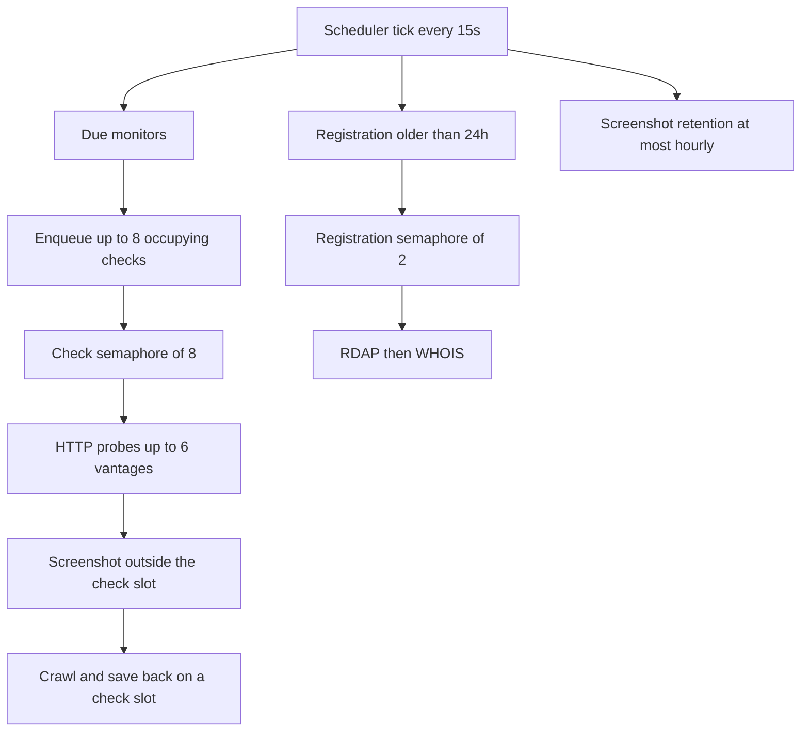

# Domain Monitor design record

Domain Monitor is a single-process Python application that watches public hostnames from the machine where it is installed. It stores results in a local SQLite database, can capture screenshots with a local Chromium, can crawl two layers of the same registrable domain, and can retry a check through an operator-supplied HTTP or HTTPS proxy or a mobile user agent.

Checks run on that machine. A green status is a final `2xx` response after redirects. Failures stay on the page. The app does not send email or chat alerts.

The operator quickstart is [README.md](../README.md). This directory is the design record for review, later changes, and a rebuild. It describes the code as it is. It does not include anything from the `data/` directory (the database, `secret.key`, or screenshots).

## Reading order

| When you need | Read |
| --- | --- |
| How the process starts, schedules work, and shuts down | [architecture.md](architecture.md) |
| Tables, files on disk, and what is copied onto a monitor row | [data-model.md](data-model.md) |
| How one check is probed, aggregated, captured, crawled, and saved | [check-pipeline.md](check-pipeline.md) |
| Authentication, CSRF, SSRF controls, and their limits | [security.md](security.md) |
| Which networks and registries the process talks to | [external-services.md](external-services.md) |
| Ubuntu launcher, environment, data files, and version hooks | [operations.md](operations.md) |
| Pages, forms, live refresh, and how status text is chosen | [ui.md](ui.md) |
| Later work that is not current behavior | [backlog.md](backlog.md) |

[AGENTS.md](../AGENTS.md) maps a change (a check, the schema, auth, deploy, or the UI) to the document and the module to open first.

## Glossary

| Term | Meaning |
| --- | --- |
| Monitor | One saved hostname and its check options. Table `monitors`. |
| Registrable domain | The public-suffix name used for crawl scope and registration lookup. `www.bbc.co.uk` stores `bbc.co.uk`. |
| Check level | Derived label: **Status** (HTTP only), **Visual** (screenshot, with crawl, proxy, and mobile off), or **Full** (crawl, proxy, or mobile is on). See [app/levels.py](../app/levels.py). |
| Vantage | One HTTP attempt: direct desktop, direct mobile, or a proxy plus a profile. At most six are run. |
| Check event | One completed run, including manual and scheduled runs. Table `check_events`. |
| Partial | The HTTP result was saved, and the screenshot or crawl did not fully succeed. |
| Overdue | The last completed check is older than the interval plus one minute, and a check is not running now. |
| Trigger | `schedule` for the scheduler and for a domain just added, `manual` for Check now. |

## Module map

```
app/main.py                 FastAPI app, middleware, lifespan
app/config.py               Environment, data directory, session secret
app/db.py                   SQLite engine, pragmas, sessions
app/models.py               Tables
app/scheduler.py            15-second tick
app/service.py              Queue, persistence, retention, registration jobs
app/safety.py               Address blocking and proxy URL rules
app/domain_parser.py        Hostname and CSV parsing
app/levels.py               Status / Visual / Full
app/presentation.py         Status labels, overdue, redirect safety
app/templating.py           Jinja environment
app/notices.py              In-memory banners
app/clock.py                UTC timestamps
app/routes/pages.py         HTML routes and auth dependency
app/checks/runner.py        Vantages, deadline, aggregation
app/checks/http_check.py    HTTPS then HTTP probes
app/checks/screenshot.py    Local Chromium
app/checks/crawl.py         Same-site crawl and robots.txt
app/checks/registration.py  RDAP then WHOIS
app/checks/agents.py        Desktop and mobile user agents
app/checks/types.py         Result dataclasses
app/templates/              Server-rendered pages
app/static/                 CSS, fonts, favicon, vendored HTMX
```

Tests live in [tests/](../tests/). They lock in fallbacks, vantage caps, crawl scope, private-address refusal, domain parsing, CSV limits, and the detail-page summary. Extend the matching test when changing that behavior:

| Area | Test module |
| --- | --- |
| Scheme fallback, retries, partial saves, deadline, shutdown | [tests/test_fallbacks.py](../tests/test_fallbacks.py) |
| Check level, proxy and mobile vantages, crawl scope, screenshot address guard | [tests/test_check_level.py](../tests/test_check_level.py) |
| Hostnames, CSV, blocked addresses, proxy URL shape | [tests/test_domain_parser.py](../tests/test_domain_parser.py) |
| Detail-page folds and screenshot marks | [tests/test_detail_page.py](../tests/test_detail_page.py) |

The same modules cover a successful login, a wrong password, a missing CSRF token, the login throttle, the HTTPS-only cookie setting, the retention sweep, a screenshot path outside `DATA_DIR/screenshots`, and `::ffff:127.0.0.1` classified as loopback. Login, CSRF, the throttle, and the cookie setting are in [tests/test_fallbacks.py](../tests/test_fallbacks.py). Retention and the screenshot path are in [tests/test_detail_page.py](../tests/test_detail_page.py). The mapped loopback address and a direct connection to the classified address are in [tests/test_domain_parser.py](../tests/test_domain_parser.py).

## Runtime shape

One Uvicorn process owns the HTTP server, the SQLite file, the scheduler, and Chromium. There is no separate worker, queue broker, or cloud database. Concurrency inside that process is a check semaphore of 8, a registration semaphore of 2, and a lock that runs one screenshot capture at a time. Each check stops after 180 seconds and saves whatever finished.


