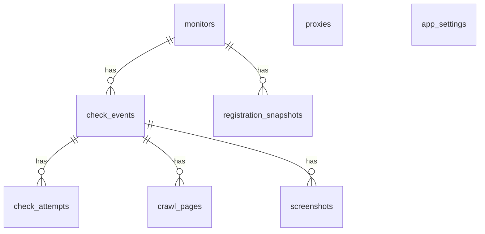

# Data model

All durable state is a SQLite file at `DATA_DIR/monitor.db`, plus JPEG files under `DATA_DIR/screenshots/` and the session secret at `DATA_DIR/secret.key`. The ORM is [app/models.py](../app/models.py). The engine setup is [app/db.py](../app/db.py).

`Base.metadata.create_all` creates missing tables. It does not add columns to a table that already exists, and there is no migration package. Rebuilding against an old `monitor.db` keeps the old schema until that file is replaced or altered by hand.

On each connection the engine sets:

- `PRAGMA journal_mode=WAL` (so `monitor.db-wal` and `monitor.db-shm` appear beside the database)
- `PRAGMA busy_timeout=5000`
- `PRAGMA foreign_keys=ON`

Sessions use `expire_on_commit=False`.

## Relationships

Deleting a `monitors` row deletes its events and registration snapshots (`ON DELETE CASCADE` in the foreign key, and SQLAlchemy `delete-orphan` on the relationships). Deleting an event deletes its attempts, crawl pages, and screenshot rows the same way. Screenshot files are removed in Python before the monitor row is deleted. Cascade does not delete files by itself.

`proxies` and `app_settings` are global. They are not owned by a monitor. `check_attempts.proxy_id` stores the proxy id that was used, without a foreign key, so a later proxy delete leaves the historical label intact.

## `monitors`

One row per hostname. `hostname` is unique and indexed, stored in Unicode lowercase after parsing. `registrable_domain` is the public-suffix registrable name (`www.bbc.co.uk` stores `bbc.co.uk`) and is what registration lookup and crawl scope use.

| Column | Role |
| --- | --- |
| `interval_minutes` | 1, 5, 15, 30, or 60. Default 5. |
| `screenshot_enabled`, `crawl_enabled`, `use_proxy`, `mobile_ua` | Option flags. Check level is computed from these, not stored. |
| `created_at`, `updated_at` | UTC. `updated_at` changes when the setup form is saved. |
| `last_checked_at` | Finish time of the last check, including a crashed check. |
| `next_check_at` | Indexed. The scheduler selects rows where this is null or due. Set to now when the monitor is created, staggered on startup, and set to `finished_at + interval` when a check is saved. Saving setup moves it earlier when `last_checked_at` plus the new interval (or now, if the monitor has never finished a check) is sooner than the stored time. A longer interval does not move it. |
| `last_status_code`, `last_error`, `last_scheme` | Copy of the display result from the last check, so the list page does not join events. |
| `last_partial`, `last_partial_reason` | Copy of the partial flag. Reason is at most 300 characters on the event. The monitor column is the same string. |

The list page reads these copies. History on the detail page reads `check_events`.

## `check_events`

One row per run.

| Column | Role |
| --- | --- |
| `trigger` | `schedule` or `manual`. Width 16. |
| `started_at`, `finished_at` | UTC. `finished_at` is null only if a write was interrupted before the row was finished. Normal saves always set it. |
| `status_code`, `error`, `scheme` | Display result after vantage aggregation. `scheme` is `https` or `http`. |
| `partial`, `partial_reason` | True when a status code was saved and the screenshot or crawl did not fully succeed. |
| `screenshot_outcome` | `skipped`, `succeeded`, or `failed`. Default `skipped`. |
| `screenshot_error` | Present when the outcome is `failed`. |
| `crawl_outcome` | `skipped`, `succeeded`, `partial`, or `failed`. |
| `crawl_error`, `crawl_note` | Failure text, or notes such as a robots.txt miss. |
| `crawl_saved`, `crawl_failed` | Page counts. |

Detail history is 50 events per page, newest `started_at` first.

## `check_attempts`

One row per vantage that actually ran (a vantage skipped because the 180-second deadline was already spent is absent).

| Column | Role |
| --- | --- |
| `vantage` | `Direct desktop`, `Direct mobile`, or `Proxy desktop (host:port)` / `Proxy mobile (host:port)`. Width 80. |
| `proxy_id`, `proxy_label` | Set for proxy vantages. The label is the host and port taken from the vantage string. |
| `profile` | `desktop` or `mobile`. |
| `scheme`, `status_code`, `error` | Result of that attempt. A transport failure has an error and a null status code. |
| `latency_ms` | Milliseconds for that attempt, including a failed attempt when the client returned. |
| `final_url` | URL after redirects. |
| `last_modified` | The `Last-Modified` response header, stored as received. |

The list is ordered by insertion id, which follows vantage order.

## `crawl_pages`

Pages the crawler recorded for one event.

| Column | Role |
| --- | --- |
| `url` | Normalized URL (lowercase scheme and host, path kept, query and fragment removed). |
| `depth` | 0 is the homepage, 1 is the first link layer, 2 is the second. |
| `status_code`, `error` | HTTP result or a short error such as a blocked address or an off-site redirect. |
| `title` | Document title, collapsed whitespace, at most 200 characters. |

## `screenshots`

| Column | Role |
| --- | --- |
| `viewport` | `desktop` or `mobile`. |
| `path` | File name of the JPEG under `DATA_DIR/screenshots`, or null after retention or a failed write. An older absolute path that still points at a file inside the current screenshots directory is rewritten to the file name when that image is served. |
| `error` | Capture or storage error. Retention sets this to `Image removed by retention.` and clears `path`. |
| `created_at` | The check finish time. Retention compares this to the retention window. |

Files are `{event_id}-{viewport}.jpg` inside `DATA_DIR/screenshots`. The HTTP route that serves them checks that the resolved path stays under that directory. The database path is the source of the file name. The route does not accept a caller-supplied path.

## `registration_snapshots`

Append-only history of registry lookups for the monitor's registrable domain. After each insert, rows beyond the newest 30 for that monitor are deleted.

| Column | Role |
| --- | --- |
| `fetched_at` | When this lookup finished. The scheduler treats the max of these as the last attempt, including failures. |
| `success`, `error` | A failed lookup is stored. The UI keeps showing the newest successful row when a later lookup fails. |
| `source` | `rdap` or `whois`. |
| `registrar` | Text, truncated to 300 characters on the way in. |
| `created_date`, `updated_date`, `expires_date` | Timezone-aware datetimes when the library returned datetimes. Other shapes are stored as null. |
| `nameservers`, `statuses` | JSON arrays of strings. Nameservers are lowercased and trailing dots are stripped. |

## `proxies`

The shared pool. A monitor uses it only when `use_proxy` is true, and only rows with `enabled` true are loaded into a check.

| Column | Role |
| --- | --- |
| `url` | Full proxy URL, including userinfo when the operator pasted it. Stored as text. The settings list shows host and port only. |
| `enabled` | Toggled from Settings. |
| `last_error`, `last_error_at` | Set when a proxy attempt finishes with an error and no status code. Cleared when a later attempt through that proxy returns a status code. |
| `created_at` | UTC. |

## `app_settings`

A single row, `id=1`. `retention_days` is 7, 30, or 90. The form rejects any other value. The default inserted at startup is 30.

## Retention and delete

`maybe_retain` runs from the scheduler tick, in a worker thread, and returns immediately when the last sweep was less than an hour ago. `retain_screenshots` loads `retention_days` and uses that window for both files and check history. Screenshot rows older than the window that still have a path lose the file, then `path` is set to null and `error` to `Image removed by retention.` Check events whose `finished_at` is older than the same window are deleted, and their attempts, crawl pages, and screenshot rows go with them. Files for those events are unlinked first. Events still inside the window stay on the detail page, and the file sweep does not remove their images.

Screenshot files and registration snapshots are the rows that get trimmed. `check_events`, `check_attempts`, and `crawl_pages` stay for the life of the monitor. Deleting the monitor is what removes them.

`delete_monitor` unlinks every screenshot file for that monitor, then deletes the monitor row and commits. History, crawl pages, attempts, and registration snapshots go with the row.

## What is not stored

- Session contents (auth flag, CSRF token, flash messages) live in the signed cookie, not in SQLite.
- Banners for the browser, disk, registration, and scheduler live in process memory.
- Crawl HTML is not stored. Only the URL, status, error, and title are kept.
- The raw RDAP or WHOIS payload is not stored. Only the mapped fields above are kept.
- There is no user table. The optional password is an environment variable.
